# 3D point tracking baselines on iPhone manipulation videos

Five 3D point trackers run on six tabletop manipulation clips recorded with an iPhone (Stray Scanner:
RGB, LiDAR depth, intrinsics; fixed tripod), with identical frames and query points, plus a viser
viewer for exploring each run.

| Method | Settings | Folder |
| --- | --- | --- |
| SpatialTrackerV2 | `rgb`, `rgbd_fixed` | `spatracker_v2/` |
| DELTA (sparse 3D) | `rgb` (UniDepth V2 depth), `rgbd_fixed` | `delta/` |
| TrackCraft3R | `rgb` (Depth Anything 3 depth + camera), `rgbd_fixed` | `trackcraft3r/` |
| Track4World | `rgb` | `track4world/` |
| TraceAnything | `rgb` | `traceanything/` |

`rgb` = video only; `rgbd_fixed` = iPhone LiDAR depth and intrinsics with the camera held fixed (only
for methods that accept external depth). Clips: `pour_lid`, `pen`, `stir`, `shoelace`, `paper_fold`,
`shirt_fold`. All methods see the same frames (10 fps, at most 200 frames per clip) and track the same
1,152 query points (a 32x24 grid on frame 0 plus 16x12 grids at 1/3 and 2/3 of the clip).
A short analysis of the first round is in [RESULTS.md](RESULTS.md).

## Demos

About 4 s of `pen` and 5 s of `paper_fold` at recording speed, from the video-only (`rgb`) runs.

| Method | `pen` | `paper_fold` |
| --- | --- | --- |
| SpatialTrackerV2 | 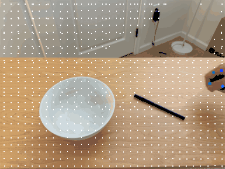 | 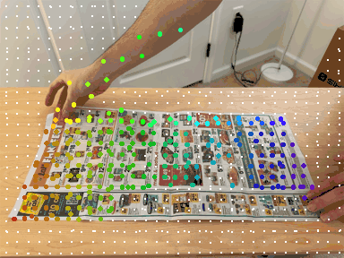 |
| DELTA |  | 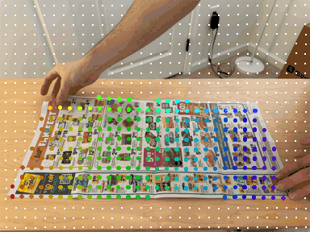 |
| TrackCraft3R | 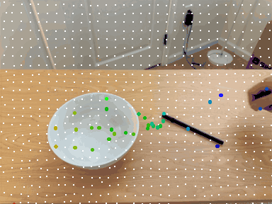 | 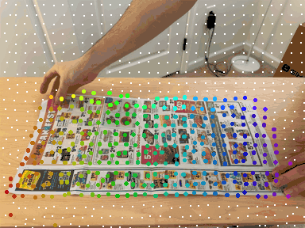 |
| Track4World | 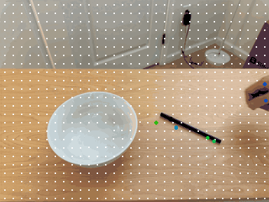 |  |
| TraceAnything | 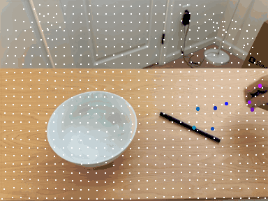 | 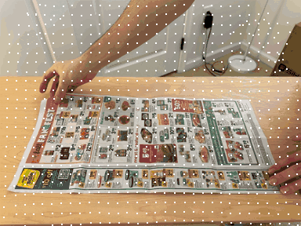 |
| MotionCrafter | 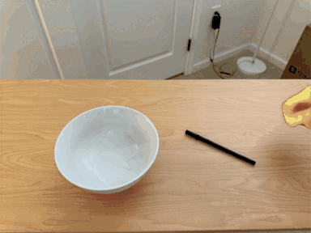 | 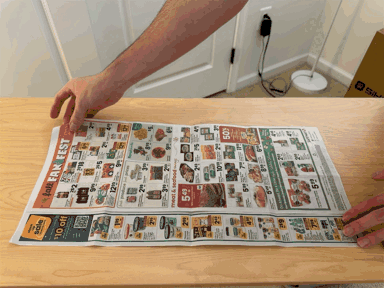 |
| ZeroMSF | 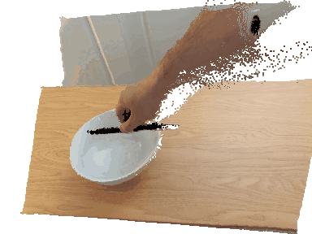 | 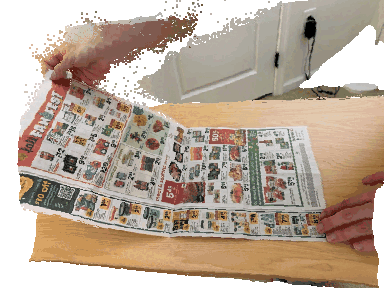 |

- Point trackers: the tracks drawn on the video. White dots are points of the frame-0 grid that stay
  still; colored dots with a short trail are points (from all three query grids) that move more than
  40 px at 1920x1440 in the segment. The color encodes the query position, so a point has the same
  color for every method. Points the method marks as occluded are hidden.
- MotionCrafter: each pixel's motion to the next frame, tinted from red (small) to yellow (large).
- ZeroMSF: the 3D points of one frame (231 in `pen`, 208 in `paper_fold`) moving along the predicted
  flow to the frame 1.0 s later, seen from a viewpoint turned by 12 degrees.

## Browse the results (no GPU needed)

1. Clone this repository.
2. Download `track3d_data.zip` (about 7.0 GB) from the Google Drive link shared with you, and unzip it
   in the repository root. It adds `preprocessed_data/` and `<method>/results/` next to the code. On a
   machine without a browser:

   ```bash
   pip install gdown && gdown --fuzzy "<Google Drive link>"   # saves track3d_data.zip
   unzip track3d_data.zip
   ```
3. Start the viewer and open http://localhost:8080:

   ```bash
   bash viewer/run_viewer.sh --clip pen
   ```

   The first run creates `.venv/` with the packages in `viewer/requirements.txt` (needs Python 3.12 or
   newer, or `uv`). On a remote machine, forward the port: `ssh -L 8080:localhost:8080 <host>`.

Use the **Method / setting** dropdown to choose a run. The 3D viewport frames that run's point cloud,
tracks, trails and camera, and the RGB image shows its 2D tracks. You can scrub or play frames, show
only moving tracks, and scale non-metric runs (TraceAnything) to the LiDAR depth.
`bash viewer/run_viewer.sh --check` validates every result file without starting a server.

## Scene-flow methods (separate viewers)

MotionCrafter and ZeroMSF predict scene flow (the 3D motion of every pixel to the next frame or to a
second image), not point tracks. They are run the official way and shown in their own viewers, which
follow the official visualization scripts, instead of the comparison grid above.

| Method | Input | Folder |
| --- | --- | --- |
| MotionCrafter | each clip's frames at 512x384, official `run.py` defaults | `motioncrafter/` |
| ZeroMSF | three image pairs per clip: a frame with much hand motion and the frames 0.1, 0.3 and 1.0 s later | `zeromsf/` |

```bash
.venv/bin/python motioncrafter/view_motioncrafter.py --clip pen
.venv/bin/python zeromsf/view_zeromsf.py --clip paper_fold
```

Both use the `.venv` that `viewer/run_viewer.sh` creates and serve on port 8080 (`--port` to change
it). MotionCrafter's `run.py` processes each clip in independent 25-frame windows, so its point maps
jump at frames 25, 50, ...; the viewer shows which window a frame belongs to. Their results are part
of `track3d_data.zip`.

## Re-run a method (GPU)

Each method folder has three files (the scene-flow folders also hold their viewer):

- `setup_env.sh`: one-time install of Miniforge, a Python env, the official code at a pinned commit, and
  every checkpoint (cached under `<method>/work/`, so jobs can run without internet).
- `run_<method>.py`: the runner; it reads frames with `common/track3d_data.py` and writes
  `<method>/results/` (layout under Result format below).
- `run_<method>.sbatch`: the job script; submit it with Slurm (`sbatch`) or run it with plain `bash`.

```bash
cd spatracker_v2
bash setup_env.sh                 # needs internet; 5-15 minutes
bash run_spatracker.sbatch        # or: sbatch run_spatracker.sbatch
```

Finished runs are skipped, so a failed or interrupted job can simply be started again. Tested on an
NVIDIA A100 80GB (Linux, CUDA 12.x driver). Peak GPU memory: SpatialTrackerV2 about 60 GB on the longest
clip, MotionCrafter 39 GB, Track4World 30 GB, TraceAnything 21 GB, DELTA 18 GB, TrackCraft3R 17 GB,
ZeroMSF 7 GB. Do not use Blackwell GPUs
(B200, RTX 5090, RTX PRO 6000): the pinned PyTorch versions do not support them. Containers that show
every host core but cap CPU time need `OMP_NUM_THREADS` near the granted vCPU count (the job scripts
default to 8, or `SLURM_CPUS_PER_TASK`).

## Result format

Point trackers, `<method>/results/<clip>/<setting>/`:

- `tracks.npz`: `queries` (N, 3) as [t, x, y]; `tracks2d_orig` (T, N, 2) in 1920x1440 pixels;
  `tracks3d_world` (T, N, 3) in the first camera's frame (OpenCV axes, meters for metric methods);
  `tracks3d_cam`, `track_depth`, `vis` (visible when > 0.5), `conf`, `c2w`, `intrinsics`, `frame_idx`
  (original Stray frame numbers), `timestamps`, `fps`, `size`, `orig_size`, `settings`.
- `result.npz`: per-frame depth, intrinsics, world-to-camera extrinsics and frames (for point clouds).
- `overlay.mp4` (2D tracks on the video) and `log.json` (settings, runtime, GPU memory, notes).

MotionCrafter, `motioncrafter/results/<clip>/`:

- `<clip>.npz`: `point_map` (T, 384, 512, 3) float16, the 3D point of every pixel in each frame;
  `scene_flow` (T, 384, 512, 3) float16, the 3D motion of every pixel from frame t to frame t+1, so
  `point_map[t] + scene_flow[t]` is where the point moves; `valid_mask` and `deform_mask`
  (T, 384, 512) bool, true everywhere in these runs. The points are in model units, not meters, with
  the origin inside the scene, so z is not depth. Points from different 25-frame windows do not line
  up.
- `log.json`: `frame_idx` (original Stray frame numbers of the T frames), `timestamps`, `fps`,
  `window_starts`, settings, pinned commit and checkpoints, runtime and GPU memory.

ZeroMSF, `zeromsf/results/<clip>/f<a>_f<b>/`, where a and b are the original Stray frame numbers of
the two images:

- `points_3d.npy` (1, 384, 512, 3): the 3D point of every pixel of image 1, in camera-1 coordinates
  (OpenCV axes, model units).
- `scene_flow.npy` (1, 3, 384, 512), channels first: the 3D motion of every pixel of image 1 until the
  time of image 2. Move the channel axis last and add it to `points_3d` to get the moved points.
- `img_colors.npy` (1, 3, 384, 512), channels first: the RGB colors of image 1 in [0, 1].
- `0_f<a>.png` and `1_f<b>.png` (the two input images at 512x384) and `log.json` (frame numbers,
  timestamps, gap, settings, pinned commit and checkpoint, runtime, GPU memory).

Both scene-flow `results/` folders also hold `summary.json` (one entry per run), `run_log.txt` and
`setup_log.txt`.

## Preprocessing

`common/preprocess_stray.py` turns the raw Stray Scanner recordings into `preprocessed_data/` (frames as
JPEG at 960x720, raw LiDAR depth and confidence, intrinsics, timestamps). It decodes video with macOS
AVFoundation, so it runs on a Mac only; the archive above already contains its output.
`common/track3d_data.py` (`load_clip`, `load_frames`) is the loader every method and the viewer use.
