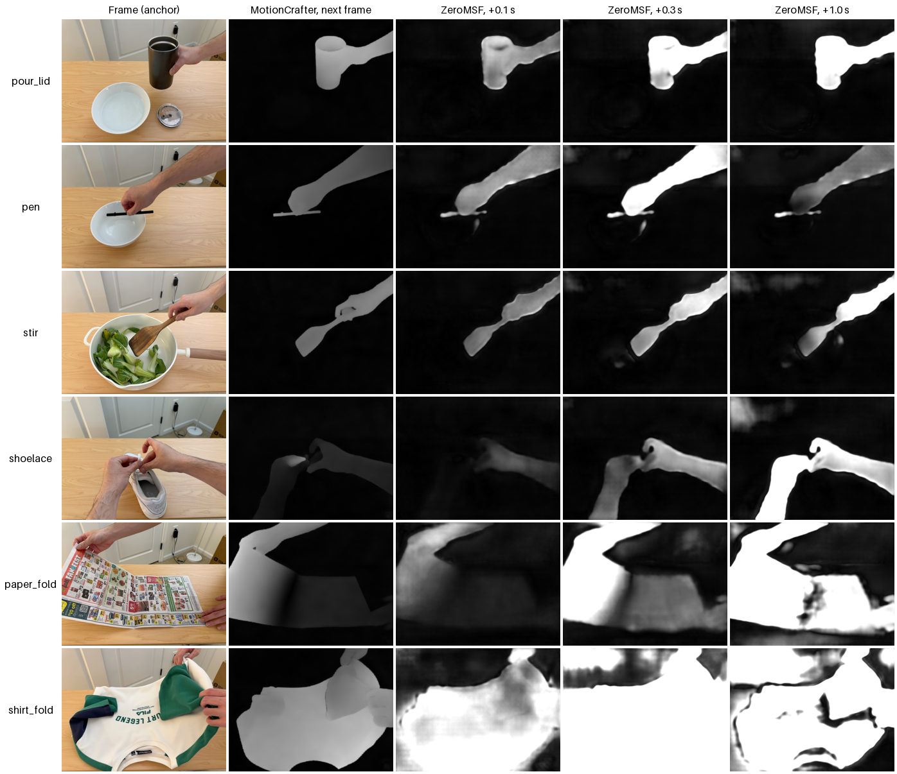

# Results: first round

Five 3D point trackers on six iPhone manipulation clips, run with their official code and default
settings on the same frames (10 fps, or 7.5 fps for the two longest clips to stay under 200 frames;
113-185 frames per clip) and the same 1,152 grid query points.
`rgb` = video only; `rgbd_fixed` = iPhone LiDAR depth and intrinsics with the camera held fixed.
All 48 runs finished without errors (one NVIDIA A100 80GB per method).
The last section covers two scene-flow methods, MotionCrafter and ZeroMSF, which are run separately.

## Depth vs. LiDAR

For every visible track point, the predicted depth is compared with the iPhone LiDAR depth
(high-confidence pixels only) at the pixel where the method places the point, over all frames of all
clips (480k-605k samples per run). Each clip first gets one scale factor (median LiDAR / predicted
depth); the error is the median relative depth error after that scaling.

| Method (`rgb`) | Error after scaling, median over clips | Range over clips | Predicted / LiDAR depth before scaling |
| --- | --- | --- | --- |
| SpatialTrackerV2 | 1.6% | 1.0-3.4% | 1.27 |
| Track4World | 2.4% | 1.6-5.4% | 1.23 |
| TrackCraft3R (DA3 depth) | 2.6% | 1.6-8.8% | 1.19 |
| DELTA (UniDepth V2 depth) | 3.2% | 2.3-5.3% | 1.22 |
| TraceAnything | 7.5% | 5.1-13.3% | 0.12 (not metric) |

- After scaling, four of the five methods recover the scene geometry to within a few percent;
  SpatialTrackerV2 is closest to the LiDAR.
- Before scaling, the methods that predict metric depth all place these close-range scenes 19-27% too
  far, so none of them gives accurate absolute depth here.
- TraceAnything is not metric and stretches the far background, which causes most of its error.
- With LiDAR as input (`rgbd_fixed`), the errors are 0.2-0.8%; this mainly confirms that the protocol
  is consistent.
- The score measures depth at the pixel where a method places a point. It does not show whether the
  point is tracked correctly.

## Motion

The camera is static, so most points should stay still. Share of tracks that move more than 60 px
(in 1920x1440 pixels) from their query position at some point, over all clips:

| Method | `rgb` | `rgbd_fixed` |
| --- | --- | --- |
| TraceAnything | 8% | |
| SpatialTrackerV2 | 12% | 12% |
| DELTA | 20% | 20% |
| Track4World | 21% | |
| TrackCraft3R | 24% | 27% |

The figure shows only the tracks that move more than 60 px, on the busiest frame of each clip, with a
10-frame trail. Colors encode the query position, so the same point has the same color in every column.

- DELTA and Track4World keep motion on the hands and the manipulated objects.
- TrackCraft3R also moves static objects, such as the bowl in pour_lid and pen.
- TraceAnything misses the paper fold: in paper_fold only 34 of its tracks move, against 391-436 for
  DELTA, Track4World and TrackCraft3R. It does follow the shirt (345 moving tracks in shirt_fold).
- SpatialTrackerV2 drags some points along the arm in pen and covers less of the paper and the shirt
  (287 and 306 moving tracks, against about 400 and 600 for DELTA and Track4World).

## Scene-flow methods

MotionCrafter and ZeroMSF predict scene flow (the 3D motion of every pixel), not point tracks, so they
are not part of the comparison above. Both run with their official code and default settings at
512x384:

- MotionCrafter on each clip's frames (the same frames as above), giving the flow from each frame to
  the next. Its `run.py` processes the clip in independent 25-frame windows.
- ZeroMSF on 18 image pairs: in each clip, a frame with much hand motion (picked from the tracker
  results) paired with the frames 0.1, 0.3 and 1.0 s later.

Their scales are not checked against the LiDAR here, so motion is measured against each method's own
scale.

Brighter means more motion. MotionCrafter: flow from the anchor frame to the next frame, white at the
99.5th percentile of the clip. ZeroMSF: flow from the anchor frame to the frame 0.1, 0.3 or 1.0 s later,
white at 5% of the pair's median depth.

ZeroMSF per clip, for the pairs at +0.1 / +0.3 / +1.0 s. Moving pixels = flow above 2% of the median
depth; background flow = median flow of the farthest 10% of pixels (the wall behind the table), as a
share of the median depth; scale change = spread of the median depth over the three pairs, which share
the same first frame.

| Clip | Moving pixels | Background flow | Scale change |
| --- | --- | --- | --- |
| pour_lid | 11 / 11 / 12% | 0.2 / 0.3 / 0.4% | 2% |
| pen | 13 / 14 / 10% | 0.2 / 0.2 / 0.3% | 5% |
| stir | 8 / 9 / 8% | 0.1 / 0.2 / 0.2% | 3% |
| shoelace | 0 / 10 / 22% | 0.1 / 0.2 / 0.2% | 2% |
| paper_fold | 12 / 34 / 52% | 0.4 / 0.5 / 0.4% | 4% |
| shirt_fold | 70 / 88 / 82% | 0.5 / 1.4 / 2.7% | 19% |

- Both methods put the motion on the hands and the manipulated objects (cup, pen, spatula, paper,
  shirt) and keep the table and the bowls still. MotionCrafter's moving regions have sharp edges;
  ZeroMSF's are blurrier.
- Neither method keeps point identities or predicts visibility, so neither gives long-range tracks
  directly.
